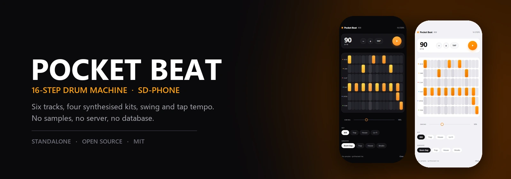
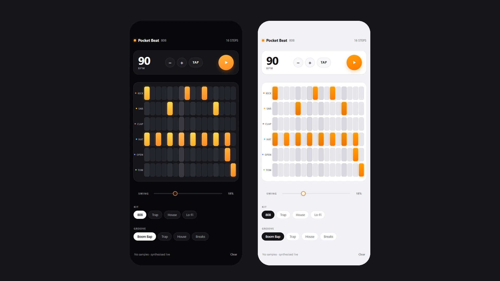

<div align="center">

# sd-pocket-beat

<a href="https://fivem.samueldev.shop/apps">
  
</a>

### A 16-step drum machine in the phone

---

sd-pocket-beat is a drum machine for [sd-phone](https://github.com/Samuels-Development/sd-phone). Six tracks, sixteen steps, four kits — and not a single audio file in the resource. Every kick, snare and hat is synthesised out of oscillators and noise the moment it plays, which is why the whole thing is 111 kB and needs no server, no database, no framework and no items.

[](https://github.com/AlexWangOlu/sd-pocket-beat)
[](https://discord.gg/FzPehMQaBQ)


[**Community apps**](https://fivem.samueldev.shop/apps) · [**sd-phone**](https://github.com/Samuels-Development/sd-phone) · [**Discord**](https://discord.gg/FzPehMQaBQ)

**Works together:** [**sd-phone**](https://github.com/Samuels-Development/sd-phone) · **sd-pocket-beat**

</div>

---

## Support Me

If you're enjoying sd-pocket-beat and want to support my work, consider picking up a script from [Samuel's Development](https://fivem.samueldev.shop) — or just star this repo and tell me what you make with it.

## Screenshots

Both screens are the real app, captured at the phone's 440 × 956 design size.

<p align="center"><a href="docs/previews/01-sequencer.webp"></a></p>

---

> [!TIP]
> **Nothing to configure, nothing to import.** There is no SQL, no item, no export to wire up and no dependency beyond the phone itself. Drop the folder in, `ensure` it after `sd-phone`, and it is in the App Store.

## Highlights

- **Six tracks, sixteen steps.** Kick, snare, clap, closed hat, open hat and tom across a classic 16-step grid. Every beat marker is a little brighter, so counting bars never needs a second look.
- **Four kits that are not samples.** 808, Trap, House and Lo-Fi are sets of synthesis parameters: the kick is a sine sweep from ~150 Hz down to ~45 Hz with a noise click on top, the snare is band-passed noise plus a tuned triangle body, the clap is three quick bursts, the hats are high-passed noise. Switch kits and the whole character changes without loading a byte.
- **Grooves to start from.** Boom Bap, Trap, House and Breaks each set the pattern, tempo, swing and kit in one tap, so a player who has never seen a sequencer still gets a beat going in two seconds.
- **Drag to paint.** Press a cell and drag across the grid to fill a run of steps at once, the way hardware is edited. Tap a single cell to hear that voice on its own before committing to it.
- **Tempo you can tap.** 60–180 BPM with a press-and-hold stepper, or tap the tempo out on the TAP key. Swing runs from straight to 60% and delays every odd sixteenth.
- **It remembers.** Tempo, swing, kit and every step are saved through the phone's own storage, so a reconnect does not cost the beat.
- **Light and dark.** Both follow the phone's theme, and both were built to be looked at, not just to be legible.

## Compatibility

| Layer | Supported |
|---|---|
| Frameworks | **Any.** QBCore, QBox, ESX, ox_core, or none at all — nothing is detected because nothing is needed |
| Phone | [sd-phone](https://github.com/Samuels-Development/sd-phone) **1.0.8 or newer**; also registers through the lb-phone compatibility layer |
| Dependencies | **None.** No `ox_lib`, no `oxmysql`, no SQL, no items, no exports to wire up |
| Storage | The phone's component storage, key `pattern-v1`, under 1 KB of the 64 KB budget |

## Installation

Start the phone, then this resource. Never the other way round — a custom app registers itself with a phone that is already running, and starting first leaves it unregistered until you restart it.

```cfg
ensure sd-phone
ensure sd-pocket-beat
```

There is no second step. No SQL, no items, no `config` to import.

By default `Config.DefaultApp = false`, so **Pocket Beat appears in the phone's App Store** for players to install. Set it to `true` in `config.lua` if you would rather every player have it on the home screen immediately.

### Opening it

| How | What it does |
|---|---|
| App Store → Pocket Beat | Installs it, then opens it like any other app |
| `/pocketbeat` | Opens the app for whoever runs the command. Handy while building a pattern |

## Using it

| Gesture | Result |
|---|---|
| Tap a cell | Toggles that step and plays the voice once |
| Press and drag across a row | Paints every cell the finger crosses to the same value |
| Play button | Starts and stops the sequencer |
| − / + | Steps the tempo by one; press and hold to sweep |
| TAP | Taps the tempo in. Four taps is enough |
| A kit pill | Swaps the whole sound set |
| A groove pill | Loads a pattern, its tempo, its swing and its kit |
| Clear | Empties the grid |

## Configuration

Two places, and both are plain.

**`config.lua`** — the identity the phone shows: `Identifier`, `Name`, `Description`, `Developer`, `DefaultApp`, the cosmetic App Store `Size` and `Price`, and `Command`.

**`ui/app.js`, the `SETTINGS` block at the top** — the musical defaults:

```js
var SETTINGS = {
  bpmMin: 60,
  bpmMax: 180,
  defaultPreset: "boombap", // the groove a fresh install opens on
  defaultSwing: 0.18,
  masterVolume: 0.9
};
```

## For developers

The interesting part is the clock. A drum machine that drifts is not a drum machine, so nothing is played straight from a timer:

- A **25 ms timer** queues hits **120 ms into the future** against the Web Audio clock (`AudioContext.currentTime`), which is sample-accurate and unaffected by the game's frame rate.
- Every queued hit is also pushed onto a **UI queue with its scheduled time**. A `requestAnimationFrame` loop drains that queue as the audio clock reaches each entry, so the playhead you see is the playhead you hear.
- Swing delays every **odd sixteenth** by up to 60% of a sixteenth. The grid stays evenly spaced; only the audio moves.

```
sd-pocket-beat/
├── config.lua           identity shown in the App Store
├── client.lua           registers the app, re-registers after a phone restart
├── fxmanifest.lua       whitelists ui/, declares ui_page
└── ui/
    ├── index.html
    ├── style.css
    ├── app.js           synthesis, sequencer, grid, storage
    ├── icon.svg
    └── screenshot-1.png, screenshot-2.png
```

**Adding a kit** — add an entry to `KITS` in `ui/app.js` with the synthesis parameters (`f0`/`f1` pitch sweep and `pdec`/`dec` decays for the kick), then add its id to `KIT_ORDER` and `KIT_LABEL`.

**Adding a groove** — add an entry to `PRESETS` with `bpm`, `swing`, `kit` and a `steps` map of step indices per track.

No build step. The files in `ui/` are what the phone serves; edit them and restart the resource.

> [!NOTE]
> **Grid cells are `div`s, not `button`s.** Chromium hands `<button>` its own dark background when the host OS is in dark mode, which silently beats theme variables — the light theme painted every cell black until they were changed. `html { color-scheme: light }` in `style.css` covers the rest of the UI.

## Licence

MIT. Do what you like with it.
